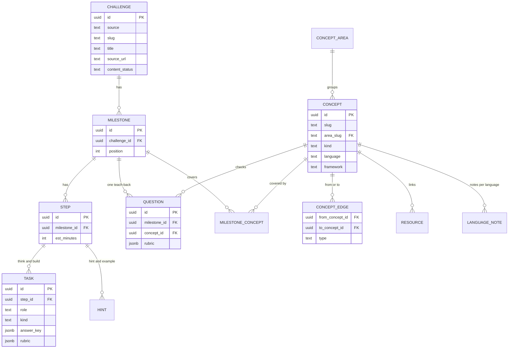
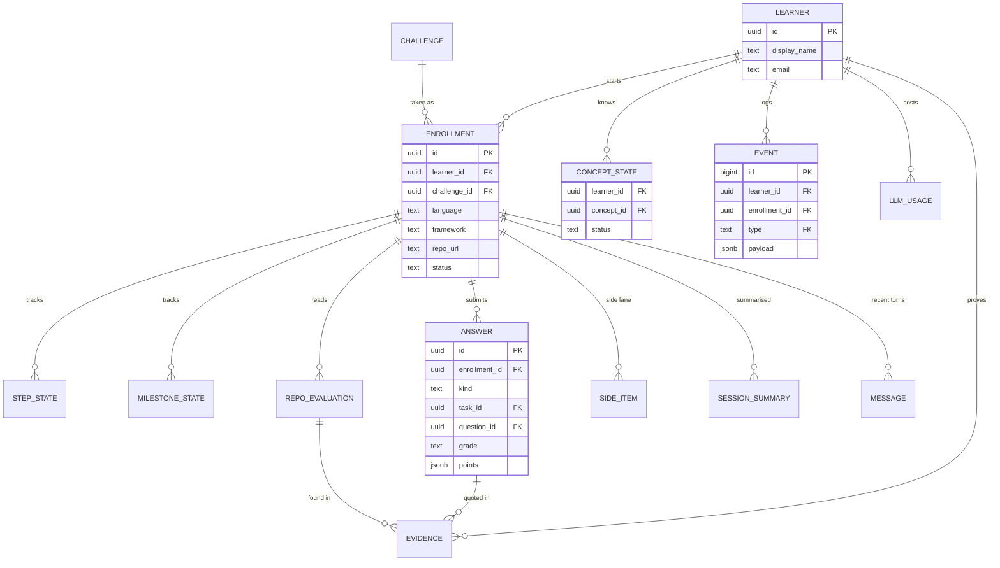

# ThinkAloud data model v0.1

PostgreSQL 15 or newer. Everything lives in Postgres, including the concept graph.
Draft for review. It follows `PRODUCT_BRIEF.md` v0.4, with decision 8 (one teach-back per milestone) applied.

Files in `db/`:

| File | What it is |
|---|---|
| `schema.sql` | All tables, constraints, triggers and views |
| `seed_reference.sql` | The ten concept areas and the event types |
| `seed_wc_sample.sql` | Test fixture: `wc` with its first concepts and milestone 1, closed by one teach-back. The live curriculum comes from `content/` |
| `seed_challenges.sql` | All 134 projects (generated from `learning-java/INDEX.md` by `scripts/import-index.mjs`) |
| `test/`, `support/` | Tests that run the schema, the workflow and all content on a real Postgres engine (PGlite). `support/recipes.mjs` holds the write recipes the tests use |
| `scripts/import-content.mjs` | Validates the YAML files in `../content`, runs the key proofs, and turns them into SQL. The format is in `CONTENT_FORMAT.md` |
| `scripts/review-sheet.mjs` | Writes `../content/REVIEW_SHEET.md`, every answer key with its derivation and proof |

Run the tests: `cd db`, `npm install`, `npm test`.

Apply to a database, in this order. The list inserts all 134 projects as listed, and the content seed fills in the
ready ones:

```
node scripts/import-content.mjs --check --verify-links --sql seed_content.sql
psql "$DATABASE_URL" -f schema.sql -f seed_reference.sql -f seed_challenges.sql -f seed_content.sql
```

`seed_wc_sample.sql` is for the tests only.

## 1. The shape

Three groups of tables.

1. **Curriculum, shared by everyone:** projects, milestones, steps, tasks, teach-back questions, concepts and the links between concepts.
2. **Learner work, one set per learner:** enrollments, answers, evidence, side items, summaries and messages.
3. **The log and its caches:** `event` is the append-only source of truth. `step_state`, `milestone_state` and `concept_state` are caches the app keeps in step with it.

### Curriculum



### Learner work



## 2. Tables

| Group | Table | Holds | Notable rules |
|---|---|---|---|
| Lookup | `concept_area` | The ten fixed areas, in order | |
| Lookup | `event_type` | The allowed event codes | New event types are an insert, not a migration |
| Curriculum | `challenge` | One of the 134 projects: source, slug, title, link, level, our summary, requirements, primer, figure kind | Unique on source and slug. `content_status` is listed, generated or reviewed. The primer has a shape check and `figure_kind` is one of the landing figure kinds |
| Curriculum | `milestone`, `step` | The path through a project | Positions are unique inside the parent. Steps are 5 to 60 minutes |
| Curriculum | `hint` | The static help for a step: a hint and an example, written once | One per step, level and language. An empty language applies to every language |
| Curriculum | `task` | A step's Think task (required) and Build task (optional) | One of each role per step. Predict and trace need an answer key, explain and spot-the-bug need a rubric of 2 to 4 points, build has neither |
| Curriculum | `question` | The milestone's teach-back (v1), or up to three older gate questions | Position 1 to 3. A teach-back has no `concept_id` and tags every rubric point with a concept slug. A trigger checks every tag is a concept the milestone covers, and the composite key does the same for `concept_id` |
| Curriculum | `concept` | A concept with its area, kind (foundation, language, framework), brief and lesson | Foundation has no language. Language has one. Framework has both. `lesson` (content v2) is `{how_it_works, examples, misconceptions, elsewhere}` with `is_lesson()` |
| Curriculum | `concept_edge` | The graph: prerequisite and related links | No self links. A prerequisite cycle is rejected by a trigger. A related pair is stored once |
| Curriculum | `milestone_concept` | Which concepts a milestone covers | |
| Curriculum | `resource` | A verified link for a concept | Shown only when the status is 200 and it has been verified |
| Curriculum | `language_note` | Language and framework notes for a concept, cached | Keyed by concept, language and framework. An empty framework means none |
| Learner | `learner` | A guest or an emailed learner | Email is optional, unique ignoring case, and checked for shape. `client_hash` (a salted hash of the caller's address) lets spend limits follow a client across guest IDs |
| Learner | `enrollment` | A learner on a project, with the optional language, framework and repo, and the support level | One per learner and project. A framework needs a language. A repo needs a language and must be a GitHub link. `support_level` is guided, standard (default) or independent |
| Learner | `answer` | Every restate, Think, gate and reflection answer, with its grade | Think points to a task, gate to a question. A reflection is never graded. A graded answer says who graded it, and a trigger checks model grades against the rubric and the quotes |
| Learner | `evidence` | Why a concept is explained or applied: a quote or a place in the repo | Points to exactly one source |
| Learner | `repo_evaluation` | One read of the repo: commits covered, messages, findings | One per enrollment and end commit |
| Learner | `side_item` | The side lane: answered questions, parked topics, extras | Never counts toward progress |
| Learner | `session_summary`, `message` | Summaries of older conversation and the recent turns | |
| Learner | `llm_usage` | Tokens and cost per model call | For the daily cap and the per-guest limits |
| Log | `event` | Everything that happens, in order | Append-only |
| Cache | `step_state`, `milestone_state`, `concept_state` | Current status, help level and time | Kept in step with the log |

Views: `v_challenge_concept`, `v_milestone_estimate`, `v_milestone_progress`, `v_enrollment_progress` and `v_help_log`. Function: `export_learner(learner_id)`.

## 3. Design decisions

- **Text with checks, not enums.** Allowed values are `check` constraints, which are cheap to change. Event types are a lookup table for the same reason.
- **Slugs for people and UUIDs for rows.** Projects and concepts have readable slugs for URLs and seeds. Every row has a UUID key, so guests cannot guess neighbours.
- **The log is the truth, the state tables are caches.** A status change and its event are written in one transaction. `concept_state`, `milestone_state` and the done, parked and help-level parts of `step_state` can be rebuilt by replaying the log. `active_seconds` cannot, because activity is not logged event by event.
- **Concept status is derived.** `concept_state.status` is a generated column over `seen_at`, `explained_at` and `applied_at`, so it cannot disagree with them. Code seen before the learner has explained the concept counts only as seen.
- **Grading integrity lives in the database.** A trigger on `answer` checks that model grades list every rubric point once, that each point claimed as met has a quote that really appears in the answer, and that the grade matches the points (all met is met, none is not yet, otherwise partial). Predict and trace tasks can be graded only by key, and explain tasks, gate questions and restate answers only by rubric.
- **Concept status belongs to the learner, not to an enrollment.** A concept explained in `wc` already shows as explained in the next project.
- **A teach-back can only test concepts its milestone covers.** For a tagged point a trigger checks it; for an older gate question with its own concept a composite foreign key does. A mismatch cannot be stored.
- **Rubrics and keys are JSON with a shape check.** They are always read whole, and their shape varies by task kind. Rubric: `[{"id": "p1", "point": "..."}]`, and a teach-back point adds `"concept": "slug"`. Key: `{"match": "number_exact" | "numbers_all" | "text_ci", "expected": ...}`.
- **Language is optional everywhere.** A null language means concept-only. Names are stored in lowercase so `Java` and `java` are one value.
- **The graph is an edge table.** The cycle trigger replaces the check a graph database would give. With a few hundred concepts, recursive queries are instant. Move to a graph database only if paths grow past about six hops, the graph reaches many thousands of nodes, or you need graph algorithms such as shortest path.
- **Append-only is enforced by the database.** Updates to `event` always fail. Deletes fail unless the transaction sets `app.allow_event_delete = 'on'`, which is how "delete my data" works.

What the app must enforce, because the database cannot:

- A milestone has one teach-back (the content checker enforces it; the schema allows up to three questions).
- A partial answer gets one follow-up.
- A quoted line in a graded answer really is in the answer.
- A grade changes status only through the rules in section 4.
- Time is counted from page activity with idle gaps over 10 minutes skipped.

## 4. Write recipes

Each recipe is one transaction. They are written as code in `db/support/recipes.mjs`, and `test/workflow.test.mjs` runs them from a guest to an understood project.

**A teach-back answer is graded**
1. Insert the `answer` with its `points` and quotes. Insert `answer_graded`, and `gate_met` when the grade is met.
2. For every met point, upsert `concept_state` for the point's concept to explained, insert `concept_explained` and `evidence` with that point's quote. This happens even when the answer is partial, so a learner keeps credit for what they explained. (An older untagged gate question marks its own concept, and only when met.)
3. If the grade is met, read `v_milestone_progress`. If `understood`, insert `milestone_understood`, update `milestone_state`, and check whether the project is now understood.

**The support level changes**
1. Update `enrollment.support_level` and insert `support_level_set` with the level. It changes what is shown, never what counts as done.

**A Think task passes**
1. Insert the `answer` (graded by `key` for predict and trace, by `model` for explain).
2. Insert `answer_graded`, set `step_state` to done, insert `step_done`.

**Help is given**
1. Insert `help_given` (and `help_level_set` if the level rose, with the learner's accept).
2. Update `step_state.help_level`.

**A repo check**
1. Insert `repo_evaluation`, `repo_checked`, and one `evidence` row per finding.
2. Upsert `concept_state` to applied where a finding says so.

**Delete my data**
1. `set local app.allow_event_delete = 'on'`.
2. `delete from learner where id = ...` removes every row of theirs. The curriculum is untouched, and `llm_usage` rows keep their cost with the learner set to null.

## 5. Queries that the tests run

**Milestone progress.** The view `v_milestone_progress` returns steps total and done, gate questions total and met, and `understood`.

**Concept status in another project.**

```sql
select c.slug, coalesce(cs.status, 'new') as status
from enrollment en
join v_challenge_concept vc on vc.challenge_id = en.challenge_id
join concept c on c.id = vc.concept_id
left join concept_state cs on cs.concept_id = c.id and cs.learner_id = en.learner_id
where en.id = $1;
```

**All prerequisites of a concept.**

```sql
with recursive up (id) as (
  select e.from_concept_id from concept_edge e
    join concept c on c.id = e.to_concept_id
   where c.slug = $1 and e.type = 'prerequisite'
  union
  select e.from_concept_id from concept_edge e join up on e.to_concept_id = up.id
   where e.type = 'prerequisite'
)
select c.slug from up join concept c on c.id = up.id order by c.slug;
```

**Suggested next:** foundation concepts that are not yet explained and whose prerequisites are all explained.

**Stuck steps:** `step_state.active_seconds > step.est_minutes * 60` while in progress.

**Daily spend:** `sum(cost_usd)` over `llm_usage` since the start of the day.

**Export:** `export_learner(learner_id)` returns one JSON document with every learner-owned table. A test checks that every table with a `learner_id` or `enrollment_id` column is in it.

## 6. Where each feature lives

| Feature | Tables |
|---|---|
| F1 Guest start | `learner`, `enrollment` |
| F2 All projects listed | `challenge` (seeded from `INDEX.md`), `milestone_concept`, `concept` |
| F3 Optional language and framework | `enrollment.language`, `enrollment.framework`, `language_note`, `resource` |
| F4 Restate step | `challenge.restate_rubric`, `answer` (kind restate) |
| F5 Concepts | `concept`, `resource`, `concept_state` |
| F6 Steps, Think and Build tasks, help | `step`, `task`, `hint`, `step_state`, `event`, `v_help_log` |
| F7 Repo check | `repo_evaluation`, `evidence`, `enrollment.repo_url` |
| F8 Memory | `concept_state`, `evidence`, `session_summary`, `message` |
| F9 Export | all learner tables, read by the export query |
| F10 Plain inputs | none |
| Gate and completion | `question`, `answer`, `milestone_state`, `v_milestone_progress` |
| Side lane | `side_item` |
| Spend cap | `llm_usage` |

## 7. Limits and open points

- The tests run on PGlite, a real Postgres engine compiled to WebAssembly. They prove behaviour, not speed, concurrency or the exact version on Zerops. Check the Zerops Postgres version (the schema needs 15 or newer).
- Open design points from the validation (curriculum versioning, generation single-flight, the parked-step rule) are in `VALIDATION.md`.

## 8. Changes for product brief v0.4 (applied 2026-10-29)

| Change | Where | Notes |
|---|---|---|
| Support level | `enrollment.support_level`, event type `support_level_set` | Recipe `setSupportLevel`. Tested |
| Primer | `challenge.primer jsonb` with `is_primer()` | `{"what", "why", "example", "words": [{"term", "meaning"}]}`, 1 to 6 words. Loaded from the project file |
| Figure | `challenge.figure_kind` | One of the 17 kinds in `design/DESIGN_SYSTEM.md` section 7. Optional |
| Teach-back (decision 8) | `question.concept_id` nullable, `question_concepts_check` trigger, position 1 to 3 | Recipe `gateAnswer` marks each met point's concept explained |
| Concept lessons (content v2) | `concept.lesson jsonb` with `is_lesson()` | Added 2026-10-29 for concept-first content. Required by the checker for every concept a `format: 2` project uses |
| Checker rules | `scripts/import-content.mjs` | Primer required, no code signs in hints, examples, primers and language notes, teach-back tags cover the milestone's concepts, every key proven by `content/proofs/<slug>.mjs` |

None of these change the progress rules: a milestone is understood when its steps are done and its teach-back is met, at every support level.
- There is one migration file, not a migration tool. Pick a tool when the schema starts to change.
- `updated_at` columns are set by the app, not by triggers.
- Only the server touches the database, so there is no row-level security. Every query for learner data must filter by the learner from the session.
- The language names are free text, lowercased. A shared list of suggestions lives in the app.
- `language_note` is keyed by concept and language, so one note serves every project that uses the concept. The brief said "per project and language" and is updated to match.
- `seed_wc_sample.sql` is a test fixture. The `wc` curriculum learners see is `content/projects/coding-challenges/challenge-wc.yaml`.
