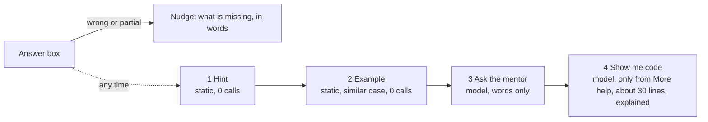
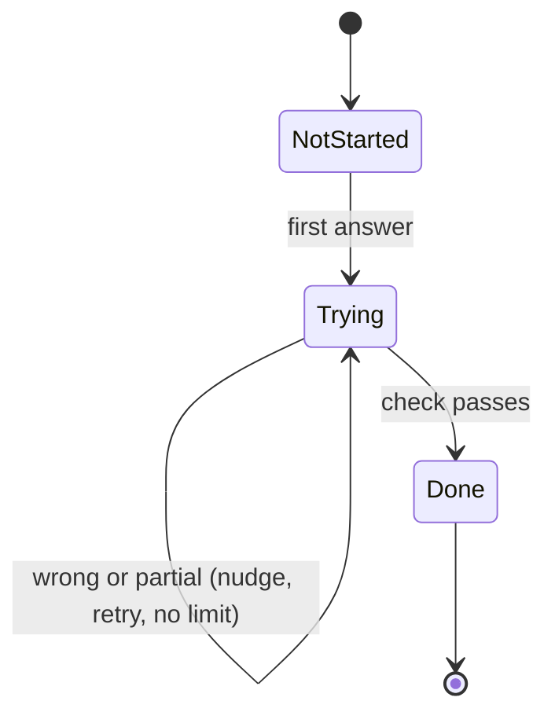

> **Superseded** by `HACKATHON_ANALYSIS.md` (2026-10-29). This file assumed a timeline, a tech stack and a forms-only UI, which the user did not accept. Kept for reference only.

# ThinkAloud: simpler plan v0.5 (proposal)

Status: **proposal, not accepted.** Nothing in `PRODUCT_BRIEF.md` changes until you confirm. Date: 2026-10-29.
Made with four plugin skills: product brainstorming (assumption testing), write-spec (P0/P1/P2), architecture (decision records) and sprint planning.

## 0. In one paragraph

Keep the idea, cut the machinery. v1 is **one path through a project**: read a short primer, then answer one check per step and one teach-back per milestone, in your own words, typed or dictated. Help is a four-rung ladder the learner climbs when they choose to. Nothing is locked. Two projects are ready, and the other 132 are listed as "coming soon". It's built as one server-rendered TypeScript app on the schema that already exists, with no schema rewrite. Everything else (support levels, the language layer, the repo check, the side lane, timers, parking, runtime generation) waits until after submission.

## 1. What the current plan gets right

| Keep | Why |
|---|---|
| Understanding first, code optional | It's the real difference from a chatbot that hands over code |
| Learner-controlled help, never refused | It comes from your own experience and is the product's character |
| Answer keys checked in code, rubrics checked with verbatim quotes | Cheap, fair and hard to game. It's already enforced by the database |
| Append-only event log | It's built, tested and makes export trivial |
| Guest first, no sign-up | It meets O1 and suits the judges |
| Content as reviewed YAML with a checker | It's the only way content quality stays under control |

## 2. Where it's too complex

Counted from the documents and the code:

| Part | Size today | Problem |
|---|---|---|
| Mechanisms in the learner flow | About 25: support levels (3 x 5 behaviours), primer, restate, 4 Think kinds, Build tasks, 3 gate questions, partial follow-up, park, dispute, side lane, Later list, "Add to track", Extras, timers with idle detection, help offers on a timer, repo check, language layer, framework layer, concept "seen", reflection, export | Each one is a screen state, a prompt branch and a test. Two days covers maybe a third of them |
| Checks per project | The static site generator has 11 step checks + 9 gate questions = 20 graded items, in 341 lines of YAML | Writing and **hand-checking** content is the real bottleneck, not code |
| Help rule | 8 rules + a support-level table + timer rules | The tutor prompt and the UI both have to encode all of it |
| Pages | 9 | A judge sees 3 or 4 of them |
| Projects listed | 134, with 1 complete | 133 cards would need runtime generation, which is the riskiest and costliest path (VALIDATION O-01, O-02) |
| Schedule | The brief had hosting live by today | It isn't started, so the plan is already a day behind |

**Riskiest assumption:** that a learner will do 20 graded checks per project. Your own manual workflow in `learning-java` was a **mentor conversation plus a progress checklist**, not a quiz engine. If the checks feel like an exam, the "never rigid" goal fails whatever the support level.

**Second riskiest:** Zerops setup. It's an unknown host with an unknown Postgres version, and no deployment has been tried yet.

## 3. Three options

| | A. Current plan, trimmed | **B. Thin spine (recommended)** | C. Mentor chat only |
|---|---|---|---|
| What it is | The brief as written, cut by the old two-day plan | Primer, one check per step, one teach-back per milestone, a help ladder and a mentor box | A chat with the help rules and a concept checklist |
| Content per project | High (about 20 checks) | Medium (about 8 to 12 checks) | Low |
| Build risk in 2 days | High | Medium | Low |
| Demo clarity | Good if finished | Good | Weak (looks like any chatbot) |
| Proof of understanding | Strong | Strong | Weak (no keys, no rubric) |
| Cost per guest | Medium | Low (hints are static, keys need no model) | High (every turn is a model call) |

**B** keeps the part that's hard to copy, which is checked understanding with evidence. It drops the parts that only pay off with many users over time.

## 4. v1 spec (option B)

### Problem
A junior learning with AI receives code they can't explain. They need to build the project themselves and prove to themselves that they understand each idea, with help that never takes over.

### Goals
1. A guest submits their first answer **within 2 minutes** of landing.
2. A learner can finish one milestone of a ready project from start to end, in about 45 minutes, with help whenever they ask.
3. Every concept marked "explained" has the learner's own words as evidence.
4. Model cost stays under the daily cap, and a typical guest costs under $0.05.
5. The demo flow runs on the live link with no errors.

### Non-goals for v1
| Not in v1 | Why |
|---|---|
| Support levels | One good default plus the help ladder covers newcomers. The levels add a matrix of states to test |
| Language and framework layer, Build tasks as a feature, repo check | Concept-only is the brief's own default. Build prompts are still shown as plain "try it yourself" text |
| Runtime generation of the other 132 projects | It's the costliest and riskiest path. Those cards are "coming soon" with a link to the original |
| Side lane, Later list, Extras, park, dispute | Nothing is locked, so skipping is just navigation. Off-topic questions get a short answer in the mentor box |
| Timers and active-time tracking | A wrong answer is a better "stuck" signal than a clock |
| Email, names, accounts | A guest ID in a cookie is enough for the hackathon |

### User stories
- As a newcomer, I want a plain-language primer first, so I know what the problem even is before I'm asked anything.
- As a learner, I want to answer each check by speaking or typing, so explaining my thinking is fast.
- As a learner who's stuck, I want a hint, then an example, then a mentor, then code if I insist, so I never hit a dead end and nobody lectures me about it.
- As a learner, I want my partial answers to get a nudge on what's missing, not just a fail, so I can add to them.
- As a learner, I want to see which concepts I've explained, in my own words, and export them, so the learning is mine.
- As a judge, I want to open the live link and reach a real check in under a minute, without signing up.

### Requirements

**P0 (must ship Friday night)**

| # | Requirement | Acceptance |
|---|---|---|
| P0-1 | Landing: ready projects first, the other 132 as "coming soon" cards linking to the original | 134 cards load. Only ready ones open a project page |
| P0-2 | Project page: primer, then milestones with progress, then "Begin" | The primer is open on the first visit and collapsed after the first answer |
| P0-3 | Guest identity: a random ID in a cookie, created on the first answer | No form before the first check |
| P0-4 | Step page: the check, the concept brief (expandable, one link), the answer box, the help ladder and feedback | Works with typing and with Wispr. On a retry the box keeps the last answer |
| P0-5 | Keyed checks (predict, trace) graded in code | The existing `keyMatches`, with no model call |
| P0-6 | Rubric checks (explain, spot the bug, teach-back) graded by the model with verbatim quotes | Points whose quote isn't in the answer are set to not met **before** the insert, so the database trigger never rejects a grade |
| P0-7 | Help ladder (section 5) | Hint and example are static. The mentor and code rungs are model calls, logged as `help_given` |
| P0-8 | Teach-back: one question per milestone, with its points tagged to concepts | A met point marks its concept explained, with the quote as evidence |
| P0-9 | Progress: step done, milestone understood, project understood (section 6) | Uses the existing views |
| P0-10 | Your learning page: concepts explained with quotes, the help log, export as Markdown and JSON | `export_learner()` |
| P0-11 | Spend cap: a daily total and a per-guest limit | When the cap is hit, the answer is kept, and the learner sees "grading paused, compare with these points" |
| P0-12 | Two ready projects: `wc` (milestone 1 reviewed, more if time) and the static site generator | Both pass `import-content --check`, each with a primer and teach-backs |

**P1 (Saturday, if time)**: the restate check on the project page, a "this grade looks wrong" link (logged), a closing reflection box, project search, Task Tracker as a third project, a dark theme.

**P2 (after the hackathon)**: support levels, the language layer, Build tasks with the repo check, runtime generation with a `generation_run` single-flight lock, the concept graph view and "suggested next", the side lane, accounts and email, spaced repetition.

## 5. Agent behaviour

Two model roles, both behind one small interface. Both get the same short rule set, adapted from the "How to explain" section of your `learning-java/CLAUDE.md`, which already worked in practice.

### The help ladder

- **The learner climbs, the app never does.** After a wrong answer the app *offers* the hint inline. After a second wrong answer it offers the example. It never offers the mentor or code by itself.
- **The "I'm not sure" button is rung 1.** It's labelled that way so it feels safe to press.
- **Every rung can be reached at any time,** with no questions asked and no limit except the spend cap.
- **There's nothing to jailbreak.** Code is one click away from the More help menu, so a learner gains nothing by arguing with the mentor. The rule only stops the agent from *volunteering* code.
- **No special "helped" state.** The milestone needs the teach-back anyway, so a concept helped by an example is still explained back in the learner's own words. That replaces rule 5 of the old help rule with no extra logic.

### The mentor (rung 3)
- **Context:** the current step, its concept briefs, the answer key or rubric (so it can steer without revealing it), and the last 6 turns *of this step only*. There are no session summaries.
- **Turns:** short, with at most one question, and always one step forward. It diagnoses before teaching and uses parallel cases.
- **Words only:** no code, no pseudo-code. An off-topic question gets one short answer and a pointer back.
- **Model:** `claude-sonnet-5-5`.

### The grader
- **Input:** the prompt, the rubric points, and the learner's answer, marked as "may be dictated: ignore filler words and transcription slips".
- **Output:** a strict JSON schema with, for each point, `{id, met, quote}`, plus one short nudge question per missing point.
- **The app then:**
  1. checks each quote with the **same normaliser as the database trigger** (lowercase, collapsed spaces)
  2. sets unverified points to not met
  3. works out the grade in code
  4. inserts the answer
- **Model:** `claude-haiku-5-5`. It's cheap, and the output is structured.
- **Failure:** a time-out, invalid JSON or a hit spend cap keeps the answer and shows the rubric as a self-check. Progress doesn't change.

## 6. Progress and gating

| Level | Done when | Not needed |
|---|---|---|
| Step | Its one check passes | Code, time spent |
| Milestone | All steps done **and** the teach-back met | Order. Anything can be answered at any time |
| Concept | A met teach-back point tagged with it (status "explained") | Clicking "I read it" (dropped) |
| Project | All milestones understood **and** the reflection box submitted (ungraded, 0 calls; the existing view needs it) | |

**Nothing is locked.** "Gate" stops meaning a wall and becomes a completion rule. Skipping a step is just going to another step, so there's no parked state. The estimate is shown as a guide only.

## 7. Content

- **Shape:** the existing format, with three changes:
  - a required `primer`
  - `gate` becomes `teach_back` (1 question, 3 to 4 points, each with a `concept` slug)
  - 2 to 4 steps per milestone instead of up to 6
- **Think kinds:** all four stay valid. In practice there are two grading paths: a key (predict, trace) or a rubric (explain, spot the bug).
- **Authoring rule:** don't write a step check that repeats the teach-back. That cuts the static site generator from 20 graded items to about 12.
- **Hints and examples:** written in words, with no backticks. The checker enforces this.
- **Ready for v1:** `wc` and the static site generator. Task Tracker is P1. Generating 10 more is P2, after submission.

## 8. Architecture

### ADR-6: One server-rendered TypeScript app
**Status:** Proposed. **Context:** solo developer, 2 days, an unknown host, plain text inputs, no rich client state.

| | A. SPA + separate API | **B. One server-rendered app** | C. Next.js |
|---|---|---|---|
| Complexity | High (2 builds, CORS, client state) | Low (forms post, HTML returns) | Medium |
| Deploy on Zerops | 2 services | 1 Node service + Postgres | 1 service, heavier build |
| Fit with Wispr | Same | Same (plain textareas) | Same |

**Decision (proposed):** B, using Hono with JSX templates and a little vanilla JS for the help buttons. It reuses `db/support/recipes.mjs` through `pg`, and the tests stay on PGlite. Choose C instead if you want React for later.

### ADR-7: Keep the schema, leave unused tables dormant
`language_note`, `repo_evaluation`, `side_item`, `session_summary`, `concept_edge`, the `parked` status and `active_seconds` stay in `schema.sql` but v1 doesn't use them. Removing them costs time and tests and saves nothing at runtime. **No schema rewrite.**

### ADR-8: Teach-back without a migration
Set `question.concept_id` to the milestone's main concept, and put the other concept tags in the rubric points' JSON (the grading trigger already allows extra keys). The checker checks that each tagged concept is in the milestone's concepts. The recipe marks every met point's concept explained. `v_milestone_progress` already works with one question. **The only schema change in v1 is `challenge.primer jsonb`.** `support_level` isn't needed.

### Hosting
- **Setup:** Zerops, with one Node service and one Postgres service. Apply `schema.sql` plus the seeds on the first deploy.
- **Timebox:** 2 hours. If it's blocked, fall back to Render or Railway with Neon Postgres, but only if Zerops isn't a challenge requirement (open question 1).

## 9. Build plan (sprint)

**Goal:** a working live link with one full milestone, submitted Friday night.
**Assumption:** about 8 focused hours a day, planned to about 75%.

| When | Item | Hours | Priority |
|---|---|---|---|
| Thu 29 | Confirm this plan and the decisions in section 10 | 0.5 | P0 |
| Thu 29 | Scaffold, deploy to Zerops with Postgres, schema and seeds applied, health page live | 2 (timebox) | P0 |
| Thu 29 | `challenge.primer`, checker (primer, teach-back, no backticks), tests green | 1.5 | P0 |
| Thu 29 | Convert the static site generator and `wc` milestone 1 to the v0.5 shape | 2 | P0 |
| Fri 30 | Landing and project pages | 1.5 | P0 |
| Fri 30 | Step page, keyed checks, static hint and example | 1.5 | P0 |
| Fri 30 | Model interface, grader with the quote check, spend cap | 2 | P0 |
| Fri 30 | Mentor and code rungs | 1 | P0 |
| Fri 30 | Teach-back, progress, concept evidence, reflection | 1 | P0 |
| Fri 30 | Your learning page and export | 1 | P0 |
| Fri 30 | Deploy, run the demo flow on the live link, **submit** | 1 | P0 |
| Sat 31 | Demo video, usage card, Flow clip, dictated README | 3 | P0 |
| Sat 31 | P1 items in order: restate, more `wc` milestones, flag a grade, Task Tracker | rest | P1 |

**Cut order if it slips:** the mentor rung (leaving hint, example and code), then the JSON export, then the second project. **Never cut:** the checks, the teach-back, or the Markdown export.

| Risk | Mitigation |
|---|---|
| Zerops blocks the deploy | 2-hour timebox, then the fallback host |
| The grader paraphrases quotes | A strict schema and the "copy exact words" rule; unverified points become not met instead of an error |
| Judges hit the spend cap | A generous daily cap; static hints and keyed checks cost nothing |
| Content keys are wrong | You check every key in the two ready projects before Friday afternoon |

## 10. How the open decisions resolve under this plan

| # | Decision | Under v0.5 |
|---|---|---|
| 1 | Help rule | Replaced by the four-rung ladder (section 5). Same spirit, with fewer rules |
| 2 | Two-day cut | Replaced by section 9 |
| 3 | All 3 gate questions met | Superseded by 8 |
| 4 | Extras in a side log | Dropped from v1 |
| 5 | Own summary plus a link | Yes |
| 6 | LLM provider and cap | Claude: `claude-haiku-5-5` grades, `claude-sonnet-5-5` mentors. **Proposed cap: $10 a day in total, 40 model calls per guest per day** |
| 7 | Product name | Keep ThinkAloud. It now *describes* the core loop: explain it out loud |
| 8 | Teach-back | **Yes**, done without a migration (ADR-8) |
| 9 | Code in the Java notes | Moot. The language layer isn't in v1 |
| V-1 | Curriculum versioning | Freeze the content once learners exist |
| V-2 | A parked step blocks Understood | Moot. There's no parked state in v1 |
| V-3 | Cache layers | Not needed. There's no runtime generation in v1 |

## 11. Open questions

| # | Question | Who answers | Blocking? |
|---|---|---|---|
| 1 | Is Zerops required by the challenge, or just your choice? | You (challenge page) | Yes, for the fallback |
| 2 | Is the deadline Friday 30 or Saturday 31? | You (challenge page) | No (plan for Friday) |
| 3 | The Zerops project, the Claude API key and the spend cap numbers | You | Yes, before Friday |
| 4 | Option B and ADRs 6 to 8, accepted? | You | Yes |
| 5 | Can you check the answer keys in `wc` and the static site generator by Friday afternoon? | You | Yes, for P0-12 |
