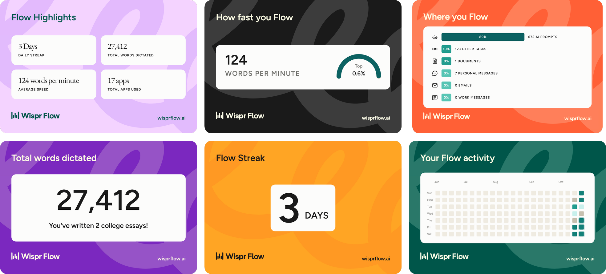

# ThinkAloud

**Fundamentals still matter, even when AI writes the code.** ThinkAloud uses AI to teach them, not to skip them: you
build real tools yourself, an agent reviews your code in a sandbox, and you explain each concept out loud.

**Try it:** https://app-2b25-3000.prg1.zerops.app · Built for the No Hands hackathon by WeMakeDevs and Wispr Flow.

## Why I built it

- **AI writes much of our code now, but understanding it is still our job.** The fundamentals underneath are what let
  you debug, change and direct what AI writes.
- **Video tutorials are static.** Each one is fixed to one version of one language or framework, and you mostly
  watch, often without writing the code.
- **Learning with AI can be dynamic.** An agent runs your code in a sandbox to review it. The mentor adapts to you: the
  same concept in Java, Python or Node.js, explained whenever you ask, with the best sources to learn from.
- **Help should never be refused.** A mentor that refused all help once left me stuck for a week. ThinkAloud helps
  whenever you ask, even with code, but you still explain the idea yourself.

## How it works

1. Pick one of 21 projects from Coding Challenges, from wc to a Redis server and a DNS resolver.
2. Show you understand the problem before writing any code.
3. Build each step in your own editor, in Java, Python or Node.js. This prototype is built for junior developers.
4. Push to GitHub. A fresh [Daytona](https://www.daytona.io/) sandbox builds your code, runs the step's checks and
   reviews only what changed since your last approved step.
5. Explain the concept behind the step, out loud. A step counts once its review passes and your explanation is
   accepted.

## Built by voice with Wispr Flow

Explaining out loud is the heart of ThinkAloud, so [Wispr Flow](https://wisprflow.ai/) is the natural way to answer:
you speak, Flow turns it into clean text in the chat box, and the mentor judges what you meant, not your typing.

I built ThinkAloud the same way. Every prompt to Claude Code was spoken through Wispr Flow instead of typed: 27,412
words dictated at 124 words per minute (top 0.6%), and 672 prompts to AI.

## Built with

- **Claude Code** wrote the app with me, and turned my raw screen recording and directions into the demo video.
- **Wispr Flow** turned every prompt and explanation into text: spoken, not typed.
- **ElevenLabs** narrated the demo video in my own cloned voice, from my script.
- **Daytona** runs the code reviews, **Zerops** hosts the app, and it's built on Next.js, PostgreSQL and LangGraph with
  Claude.

## Run it yourself

See [SETUP.md](SETUP.md) to run it locally or deploy it. More detail: [how it works](docs/architecture.md),
[content](docs/content.md) and the [design system](docs/design-system.md).

## Credits

The projects come from [Coding Challenges](https://codingchallenges.fyi/) by
[John Crickett](https://x.com/johncrickett). ThinkAloud links to each original challenge and writes its own text.

## License

[MIT](LICENSE)
